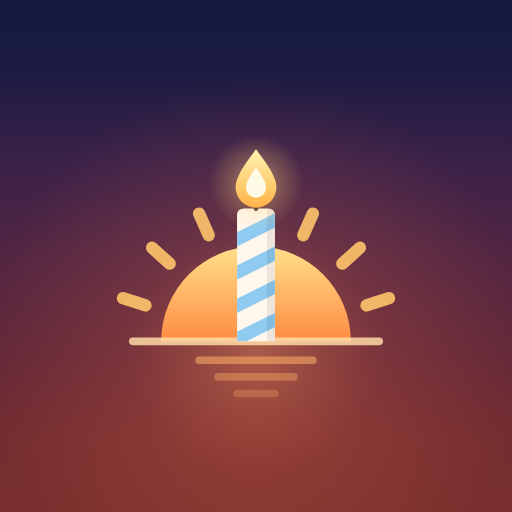
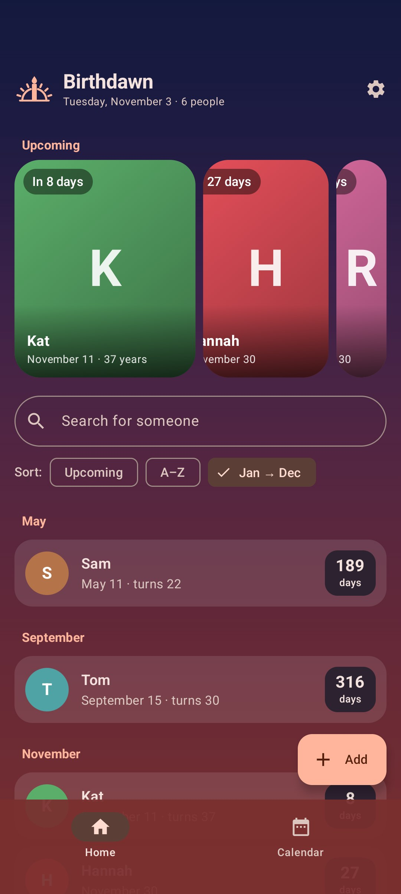
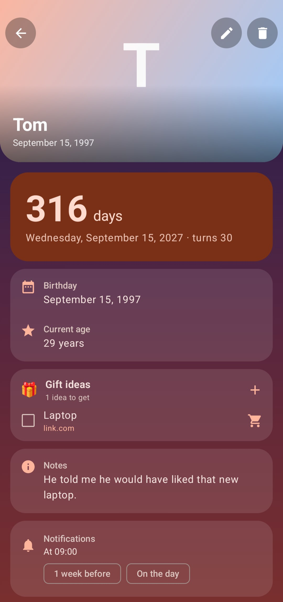
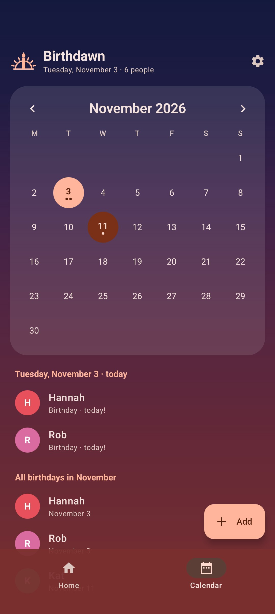
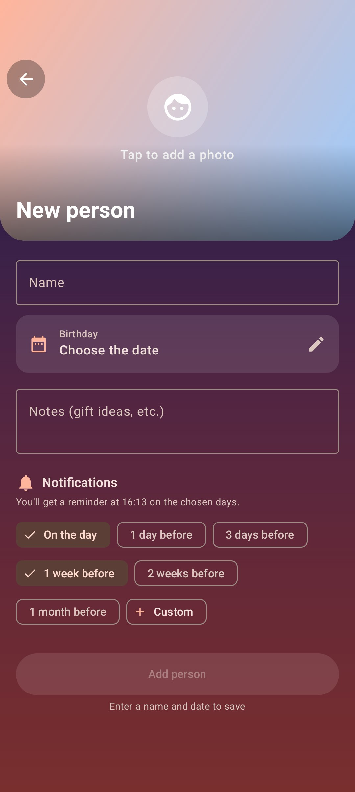
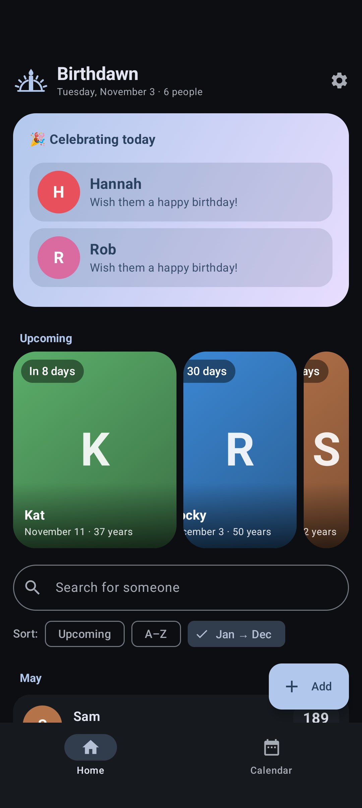
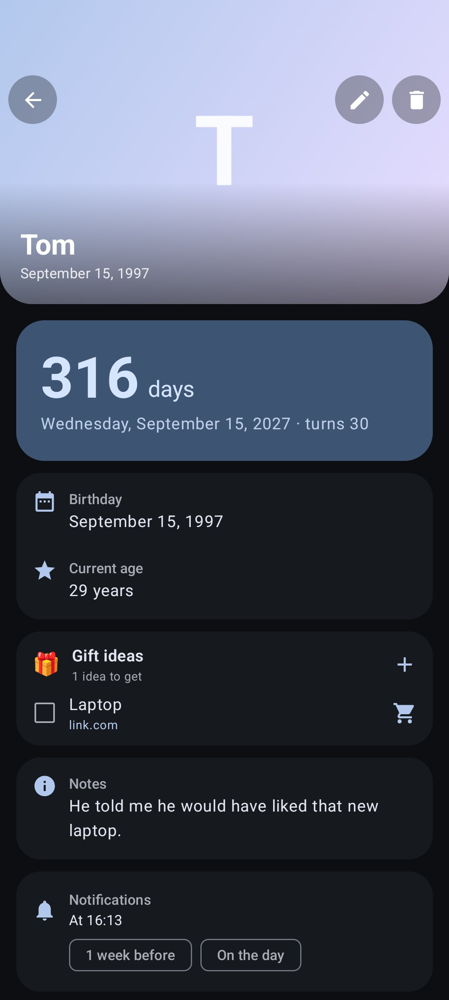

<div align="center">



# Birthdawn

### Never miss a birthday again

A beautiful, lightweight, private birthday reminder for Android — with gift ideas, photos and a sky that follows the dawn.

<br/>

[](https://github.com/LucaBernardiniii/Birthdawn/releases)
[](https://github.com/LucaBernardiniii/Birthdawn/releases)
[](https://github.com/LucaBernardiniii/Birthdawn/stargazers)
[](#download)

<br/>

[](https://kotlinlang.org)
[](https://developer.android.com/compose)
[](https://m3.material.io)

<br/>

[**Download**](#download) · [**Features**](#features) · [**Privacy**](#privacy) · [**Translate**](#translations) · [**FAQ**](#faq) · [**Build**](#build-from-source)

</div>

---

<div align="center">

<h1><a id="screenshots"></a>Screenshots</h1>








<sub>🌅 Dawn Theme · 🎨 Dark Material You Wallpaper Colours</sub>

</div>

---

<div align="center">

<h1><a id="features"></a>Features</h1>

<table>
  <tr>
    <td width="50%" valign="top">

#### 🎂 Birthdays at a glance
- Carousel of the next upcoming birthdays
- Special card for whoever is celebrating today
- Search, and sort by **upcoming**, **A–Z** or **January → December**
- Monthly calendar with every birthday marked
- Age and countdown for everyone

</td>
    <td width="50%" valign="top">

#### 🔔 Reminders that fit you
- Notified **7 days before** and **on the day** by default
- Per-person custom reminders (1 day, 2 weeks, 1 month… or any number of days)
- Choose the time of day you get notified
- Reminders survive reboots and phone-off mornings
- A birthday wish **for you** on your own birthday 🎉

</td>
  </tr>
  <tr>
    <td width="50%" valign="top">

#### 🎁 Gift ideas
- Save gift ideas for each person, with optional links
- Open the shop page in one tap, tick ideas off once bought
- **Share → Birthdawn** from any shopping app or browser to save an item instantly
- Reminders tell you how many ideas you've saved

</td>
    <td width="50%" valign="top">

#### 🖼️ People & photos
- Photo banner on every person, with drag & pinch framing
- Notes, birth year optional (Feb 29 handled too)
- Each page can take its colours from the person's photo

</td>
  </tr>
  <tr>
    <td width="50%" valign="top">

#### 🌅 Design
- **Dawn** theme: a sky that fades from blue to sunrise orange
- Light / Dark / System modes
- Material You (wallpaper colours) or a custom accent colour
- Built with Material 3, themed icon support

</td>
    <td width="50%" valign="top">

#### 💾 Your data, your phone
- 100% offline: no account, no ads, no tracking
- One-tap **backup & restore** to a single `.zip` file
- Backups include people, photos, gift ideas, your birthday and all settings
- Available in **English** and **Italian**

</td>
  </tr>
</table>

</div>

---

<div align="center">

<h1><a id="download"></a>Download</h1>

<table>
  <tr>
    <th align="center">GitHub</th>
    <th align="center">Obtainium</th>
  </tr>
  <tr>
    <td align="center">
      <a href="https://github.com/LucaBernardiniii/Birthdawn/releases/latest/download/Birthdawn.apk">
        
      </a>
    </td>
    <td align="center">
      <a href="https://apps.obtainium.imranr.dev/redirect?r=obtainium://add/https://github.com/LucaBernardiniii/Birthdawn/">
        
      </a>
    </td>
  </tr>
</table>

<h3>Requires Android 8.0 (Oreo) or newer.</h3>

</div>

**Installing:** download `Birthdawn.apk`, open it and allow installs from your browser or file manager when Android asks. On first launch, allow notifications so Birthdawn can remind you.

**Updating:** install the new APK over the old one — your data stays. With [Obtainium](https://github.com/ImranR98/Obtainium) you'll get updates automatically.

**Note:** Android might flag the app. The code is open source and can be scanned anytime.

---

<div align="center">

<h1><a id="privacy"></a>Privacy</h1>

<h3>Birthdawn doesn't even ask for internet access.</h3>

</div>

Everything — people, photos, gift ideas, settings — is stored only on your phone. There is no account, no cloud sync, no analytics and no ads. The app only asks for two permissions:

| Permission | Why |
|---|---|
| `POST_NOTIFICATIONS` | To remind you of upcoming birthdays |
| `RECEIVE_BOOT_COMPLETED` | To keep reminders scheduled after you restart your phone |

Gift links open in your own browser or shopping app, outside Birthdawn.
Want your data on another phone? Use **Settings → Backup → Export data** and import the file on the new device.

---

<div align="center">

<h1><a id="translations"></a>Translations</h1>

<h3>Birthdawn speaks 🇬🇧 English and 🇮🇹 Italian.</h3>

</div>

Choose the language in **Settings → Language**, or leave it on *Automatic* to follow your phone (Italian if your phone is in Italian, English otherwise). Notifications, dates and the system date/time pickers follow your choice.

**Want Birthdawn in your language?** All texts live in a single file:

1. Copy [`app/src/main/res/values/strings.xml`](app/src/main/res/values/strings.xml) to `app/src/main/res/values-XX/strings.xml` (where `XX` is your language code, e.g. `values-es`, `values-fr`, `values-de`).
2. Translate the text between the tags. Keep placeholders such as `%1$s` and `%d` as they are.
3. Open a pull request. Thank you! 💛

---

<div align="center">

<h1><a id="faq"></a>FAQ</h1>

</div>

<details>
<summary><b>I didn't get a notification. What should I check?</b></summary>

- Open **Settings → Send a test notification**. If nothing appears, notifications are disabled for Birthdawn in Android's settings.
- Some phones (Xiaomi, Huawei, Samsung…) aggressively stop background apps: set Birthdawn's battery usage to *Unrestricted*.
- If your phone was off at notification time, the reminder arrives as soon as you turn it on or open the app.
</details>

<details>
<summary><b>An update won't install over my current version.</b></summary>

Android only installs updates signed with the same key as the installed app. If you installed an early test build, uninstall it once (export a backup first!) and install the latest release — future updates will install normally.
</details>

<details>
<summary><b>What's inside a backup file?</b></summary>

A backup is a normal `.zip` archive:

```text
manifest.json        backup format and app version
files/people.json    people, dates, notes, reminders, gift ideas (readable JSON)
files/photos/        the photos
prefs/settings.json  your birthday, theme, notification time, language and every other setting
```

Anything Birthdawn stores in future versions is included automatically. Importing replaces all current data after asking for confirmation.
</details>

<details>
<summary><b>What happens to birthdays on February 29?</b></summary>

In non-leap years they are celebrated — and notified — on February 28.
</details>

<details>
<summary><b>Can I theme the app icon?</b></summary>

Yes. On Android 13+ enable *Themed icons* in your launcher and Birthdawn's monochrome sun-and-candle icon will follow your wallpaper colours.
</details>

---

<div align="center">
If you've read all the way down here, first of all, thank you.

This is my first android project and I hope it'll make your life a bit easier (at least when it comes to reminding birthdays).

<div align="center">

### If I helped you, please consider leaving a ⭐

[](https://github.com/LucaBernardiniii/Birthdawn/stargazers)

</div>

---

<br/>

**Made with ❤️ by [Luca](https://github.com/LucaBernardiniii)**

<sub>Birthdawn — because every birthday deserves a sunrise.</sub>

</div>
